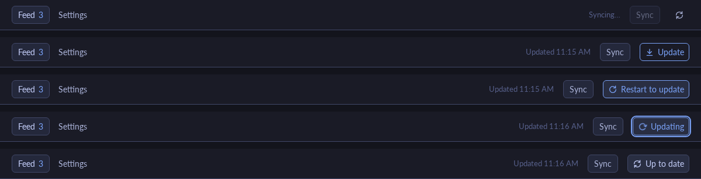

# Feed

A feed reader for [Omarchy](https://omarchy.org/): YouTube channels,
newsletters such as Substack, and any site with an RSS feed, in one list.
Videos open in Omarchy's YouTube app. Articles are saved with their images
and read here in a quiet reader, without ads, embeds or header images.

Nothing runs in the background. Feed syncs when it opens and when you press
**Sync**; its small local server stops when the window closes.


## Install

Needs Omarchy (tested with 4.5.0), Python 3.11 or newer, and Chromium
(Omarchy's default browser).

```bash
git clone https://github.com/simonmcschubert/omarchy-feed.git ~/.local/share/omarchy-feed
~/.local/share/omarchy-feed/setup
```

`setup` adds "Feed" to the app launcher (`Super+Space`). It starts the
server from the cloned directory, so keep it where it is.

## Update

Feed looks for a new release 15 seconds after it opens and every four hours
while it is open. The update button, a circle of arrows at the right end of
the top bar, checks now when clicked; hover it to see the installed version.
When there is a release, the button turns into a down arrow with **Update**.
Click it to download the release, then click **Restart to update** to install
it: Feed restarts its server with the release (after a running sync) and
reloads the window. When the new server does not answer, Feed goes back to
the version it had. A notification confirms the update or says why it
failed. When it fails before the restart (local changes in the checkout, for
example), the button says **Update failed** and why, when hovered. Like
`git pull`, this does not show the changes first; the release notes on
GitHub list them. Updates never touch the data.



Looking for releases asks the repository Feed was cloned from (GitHub) for
its tags. Nothing about the data or the sources is sent.

The same from a terminal:

```bash
~/.local/share/omarchy-feed/update check
~/.local/share/omarchy-feed/update install 0.2.0
```

With Feed open, the window reloads into the new version within a minute.
With Feed closed, `update install` starts the new server only to see that it
answers, and stops it again.

`git -C ~/.local/share/omarchy-feed pull && ~/.local/share/omarchy-feed/setup`
works too, and is how a copy installed before the update button gets it. It
takes the newest commit on `main`, released or not. `setup` stops a running
Feed server; an open Feed window then says so. Close it and open Feed again
for the new version.

## Remove

```bash
~/.local/share/omarchy-feed/setup --remove
rm -rf ~/.local/share/omarchy-feed
```

The data directory stays.

## Use

- **Feed**: new items from all sources, newest first. **Unread** and **All**
  switch what is shown; the menu next to them shows one source. Items stay
  unread until you mark them read.
- **Reader**: opens an article. It shows what was removed (for example
  "Removed: 5 ads, 1 poll"). **Open original** opens the article in the
  browser. Links open in the browser too; links to X (`x.com`) open in
  Omarchy's X app.
- **Settings**: add a source by its address, remove one, pick how the
  reader sets articles, and see where the data is. **Reader** has four
  styles: Editorial serif (Source Serif text with Inter headings, the
  default), Modern sans (Inter), Book serif (Literata) and System sans
  (Noto Sans). Feed brings the first three fonts with it. On dark themes
  their text is set a little lighter, because light text on a dark
  background looks bolder.

Videos open in Omarchy's YouTube app, and links to X in its X app. When the
app is open, Feed switches to it and the link takes the place of what it
showed. A web app can't be sent to another address, so a new window opens
where the old one is, and the old one closes; Back does not return to the
previous page. When the app is not open, it opens on the first empty
workspace of the monitor in use, the first that `Super` and a number shows
empty.

| Key | |
| --- | --- |
| `Ctrl+1` / `Ctrl+2` | Feed / Settings |
| `j` / `k` (or `↓` / `↑`) | Next / previous item |
| `Enter` or `o` | Open the item: an article in the reader, a video in YouTube |
| `m` | Mark read or unread (also in the reader) |
| `u` | Unread or all items |
| `r` | Sync |
| `Esc` | Back to the feed |
| `o` in the reader | Open the original in the browser |


## Sources

Paste an address in Settings:

| Address | What Feed does |
| --- | --- |
| A YouTube channel (`youtube.com/@name`) | Follows the channel's videos, without Shorts and live streams |
| A Substack or other site with an RSS or Atom feed | Finds the feed on the page, or at `/feed`, `/rss` and similar |
| A beehiiv newsletter without a feed | Reads its posts from the site map |

A new source starts with its three newest items, so it does not fill the
feed. After that, every sync adds what is new.

### Articles stay on this computer

During a sync, Feed downloads each new article: from the feed when the
feed has the whole text, otherwise from the web page. The page cleans it
up, and the server saves the text and the images in it. The reader shows
only these copies; the browser is told to load nothing else, so reading
contacts no website. The sites see that the article was downloaded, not
whether or when it was read.

Read items are deleted 30 days after they were marked read. Unread items are
kept.

### Ads

Newsletters mark their ads in different ways, so each one needs its own rule
in [`app/clean.mjs`](app/clean.mjs):

- **Superhuman AI**: sections with sponsor links (`shad=1`), its own
  promotions (AI Academy, advertising) and polls.
- **Ben's Bites**: the "brought to you by" block and the sponsor note at the
  end.
- **Every Substack**: subscribe boxes and buttons.
- **Every beehiiv newsletter**: polls.
- **Every source**: embedded posts, videos and polls, and an image before the
  text starts (the header image).

A source without its own rule keeps its ads until one is added. When a
newsletter changes its layout, its rule can stop working; "Removed: …" in
the reader shows what was found.

## Data

`~/.local/state/omarchy-feed/`, in a directory only the owner can open:
`feed.db` (SQLite: sources, items and the cleaned articles) and `images/`.
`server.log` holds the server's errors.

## Security

The server listens on `127.0.0.1` only. It answers only requests addressed to
`localhost:47220` or `127.0.0.1:47220` and refuses changes from other web
pages, so a website open in the browser cannot read or change the data.
Feeds and articles may only point it at public addresses, not at the local
network. Saved articles keep only plain text tags, links and images; images
are checked to be pictures (JPEG, PNG, GIF, WebP or AVIF) before they are
saved.

## Development

```text
server.py          # local server: page, API, sync, images, SQLite, /api/update
omarchy-feed       # launcher: starts the server, opens or focuses the window
setup              # launcher entry; --remove undoes
update             # finds, downloads and installs releases
server-control.sh  # starts and stops the server; the three above source it
app/
├── index.html
├── app.mjs        # Feed, Reader and Settings; the sync loop
├── clean.mjs      # article cleanup and the rules per source (no network)
├── update.mjs     # the update button
├── style.css      # including the reader's four styles
└── fonts/         # Source Serif 4, Inter, Literata (Latin, OFL)
```

Run it without installing, with its own data and without stopping by itself:

```bash
./server.py --port 8123 --data /tmp/feed-dev --idle 0
```

Then open `http://localhost:8123/`. The server reads `app/` once when it
starts, so restart it to see changes there. Tests:

```bash
npm ci                                    # jsdom for the cleanup tests
node --test                               # clean.mjs, update.mjs, the scripts
python3 -m unittest discover -s test      # server.py
```

The tests of `update`, the launcher and `setup` run them against real git
repositories, with stand-ins for `curl`, `setsid` and Omarchy's commands. A server started this way offers updates too, but
`update install` refuses a checkout that Feed's launcher entry does not
start, so installing one fails there.

## Releases

Actions › Release › Run workflow, with patch, minor, or major; the first
release starts from 0.0.0, so minor gives 0.1.0. The workflow tags the `main`
commit that passed CI as `vX.Y.Z` and creates the GitHub Release with notes
from the merged pull requests. The tags hold the version (`update version`).
Installed copies offer the release the next time Feed opens. "Release
candidate" publishes `vX.Y.Z-rc.N`, which they do not offer, and "Dry run"
shows the version and notes without publishing.
