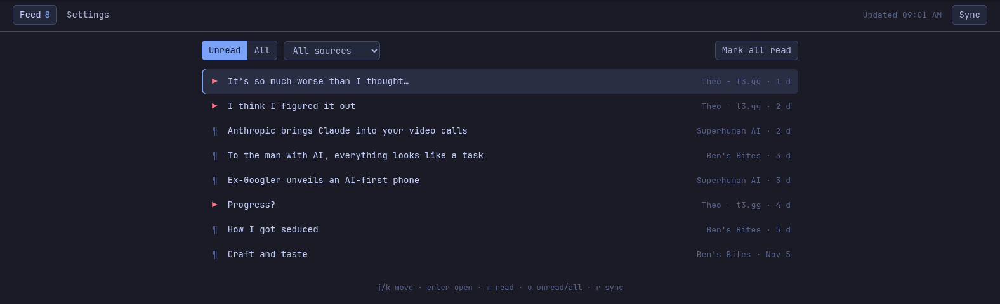
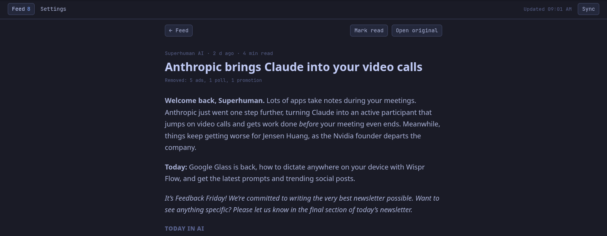

# Feed

A feed reader for [Omarchy](https://omarchy.org/): YouTube channels,
newsletters such as Substack, and any site with an RSS feed, in one list.
Videos open in Omarchy's YouTube app. Articles are saved with their images
and read here in a quiet reader, without ads, embeds or header images.

Nothing runs in the background. Feed syncs when it opens and when you press
**Sync**; its small local server stops when the window closes.



## Install

Needs Omarchy (tested with 4.5.0), Python 3.11 or newer, and Chromium
(Omarchy's default browser).

```bash
git clone https://github.com/simonmcschubert/omarchy-feed.git ~/.local/share/omarchy-feed
~/.local/share/omarchy-feed/setup
```

`setup` adds "Feed" to the app launcher (`Super+Space`). It starts the
server from the cloned directory, so keep it where it is.

## Update

```bash
git -C ~/.local/share/omarchy-feed pull && ~/.local/share/omarchy-feed/setup
```

`setup` stops a running Feed server; an open Feed window then says so. Close
it and open Feed again for the new version. Updates never touch the data.

## Remove

```bash
~/.local/share/omarchy-feed/setup --remove
rm -rf ~/.local/share/omarchy-feed
```

The data directory stays.

## Use

- **Feed**: new items from all sources, newest first. **Unread** and **All**
  switch what is shown; the menu next to them shows one source. Items stay
  unread until you mark them read.
- **Reader**: opens an article. It shows what was removed (for example
  "Removed: 5 ads, 1 poll"). **Open original** opens the article in the
  browser. Links open in the browser too; links to X (`x.com`) open in
  Omarchy's X app.
- **Settings**: add a source by its address, remove one, and see where the
  data is.

| Key | |
| --- | --- |
| `Ctrl+1` / `Ctrl+2` | Feed / Settings |
| `j` / `k` (or `↓` / `↑`) | Next / previous item |
| `Enter` or `o` | Open the item: an article in the reader, a video in YouTube |
| `m` | Mark read or unread (also in the reader) |
| `u` | Unread or all items |
| `r` | Sync |
| `Esc` | Back to the feed |
| `o` in the reader | Open the original in the browser |



## Sources

Paste an address in Settings:

| Address | What Feed does |
| --- | --- |
| A YouTube channel (`youtube.com/@name`) | Follows the channel's videos, without Shorts and live streams |
| A Substack or other site with an RSS or Atom feed | Finds the feed on the page, or at `/feed`, `/rss` and similar |
| A beehiiv newsletter without a feed | Reads its posts from the site map |

A new source starts with its three newest items, so it does not fill the
feed. After that, every sync adds what is new.

### Articles stay on this computer

During a sync, Feed downloads each new article: from the feed when the
feed has the whole text, otherwise from the web page. The page cleans it
up, and the server saves the text and the images in it. The reader shows
only these copies; the browser is told to load nothing else, so reading
contacts no website. The sites see that the article was downloaded, not
whether or when it was read.

Read items are deleted 30 days after they were marked read. Unread items are
kept.

### Ads

Newsletters mark their ads in different ways, so each one needs its own rule
in [`app/clean.mjs`](app/clean.mjs):

- **Superhuman AI**: sections with sponsor links (`shad=1`), its own
  promotions (AI Academy, advertising) and polls.
- **Ben's Bites**: the "brought to you by" block and the sponsor note at the
  end.
- **Every Substack**: subscribe boxes and buttons.
- **Every beehiiv newsletter**: polls.
- **Every source**: embedded posts, videos and polls, and an image before the
  text starts (the header image).

A source without its own rule keeps its ads until one is added. When a
newsletter changes its layout, its rule can stop working; "Removed: …" in
the reader shows what was found.

## Data

`~/.local/state/omarchy-feed/`, in a directory only the owner can open:
`feed.db` (SQLite: sources, items and the cleaned articles) and `images/`.
`server.log` holds the server's errors.

## Security

The server listens on `127.0.0.1` only. It answers only requests addressed to
`localhost:47220` or `127.0.0.1:47220` and refuses changes from other web
pages, so a website open in the browser cannot read or change the data.
Feeds and articles may only point it at public addresses, not at the local
network. Saved articles keep only plain text tags, links and images; images
are checked to be pictures (JPEG, PNG, GIF, WebP or AVIF) before they are
saved.

## Development

```text
server.py          # local server: page, API, sync, images, SQLite
omarchy-feed       # launcher: starts the server, opens or focuses the window
setup              # launcher entry; --remove undoes
app/
├── index.html
├── app.mjs        # Feed, Reader and Settings; the sync loop
├── clean.mjs      # article cleanup and the rules per source (no network)
└── style.css
```

Run it without installing, with its own data and without stopping by itself:

```bash
./server.py --port 8123 --data /tmp/feed-dev --idle 0
```

Then open `http://localhost:8123/`. Tests:

```bash
npm ci                                    # jsdom for the cleanup tests
node --test                               # clean.mjs
python3 -m unittest discover -s test      # server.py
```
